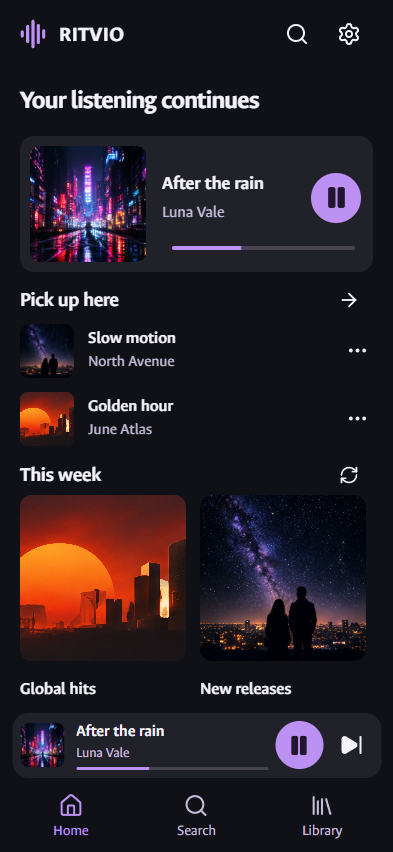
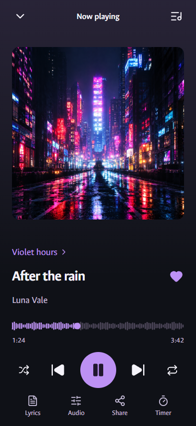
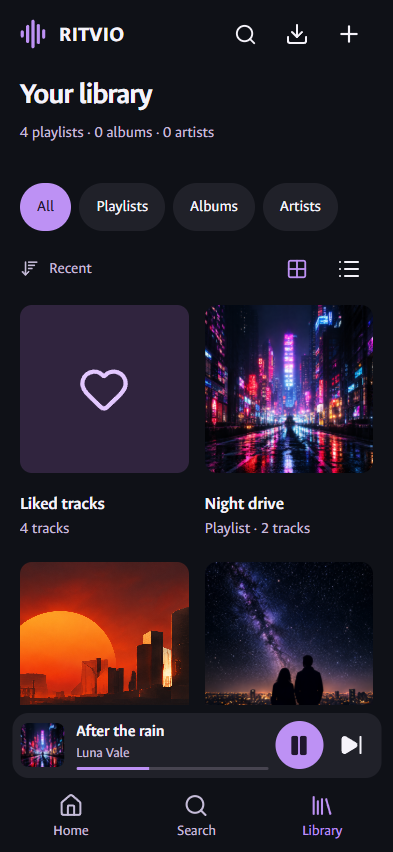
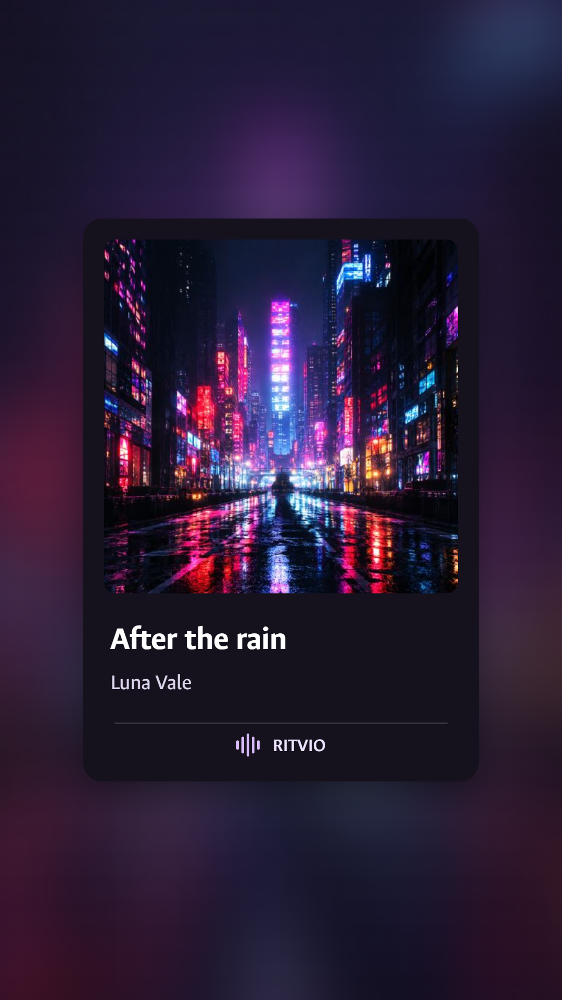
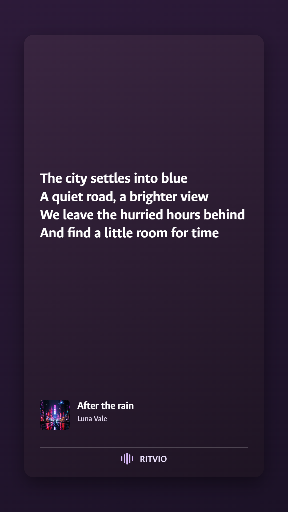

# RITVIO

**A free, open-source music player for Windows and Android.** Discover something new, keep a library of your own and make room for the music you love.

<p>
  <a href="https://github.com/salvo13200/RITVIO/releases/tag/public-preview-1"><strong>Download RITVIO</strong></a> ·
  <a href="#a-look-inside">Screenshots</a> ·
  <a href="docs/FEATURES.md">Features</a> ·
  <a href="docs/README.md">Documentation</a> ·
  <a href="https://github.com/salvo13200/RITVIO/issues">Report an issue</a>
</p>

[](https://github.com/salvo13200/RITVIO/actions/workflows/ci.yml) · [GPL-3.0-only](LICENSE) · [English](README.md) / [Italiano](README.it.md)

> **Public preview:** Windows **0.7.2** · Android **1.0.4**. Both are available now. Read the [release notes and known limits](docs/RELEASE_NOTES.md) before installing; native-device validation is still being completed.

## A look inside

### A desktop workspace for your music

[](docs/media/desktop-home.webp)

### Made for the way you listen on your phone

<p align="center">
  <a href="docs/media/mobile-home.webp"></a>
  <a href="docs/media/mobile-player.webp"></a>
  <a href="docs/media/mobile-library.webp"></a>
</p>

*Actual React interfaces rendered in English with synthetic demo data and project-generated artwork. Mobile images are browser captures, not photographs or native-device test evidence. [Explore the complete gallery](docs/SCREENSHOTS.md) for library, lyrics and sharing views.*

## Find it. Keep it. Make it yours.

| Discover | Organise | Listen | Share |
| --- | --- | --- | --- |
| Search tracks, artists and albums. Explore global hits, new releases and track radio. | Keep liked tracks, playlists, followed artists/albums and history on your device. | Edit the queue, shuffle/repeat, read lyrics, adjust audio and set a sleep timer. | Export playlist files or turn a track and a lyrics excerpt into a 9:16 image. |

Windows has a full desktop workspace, an immersive player and a mini-player. Android has its own touch interface with native Media3 playback, system media controls and a background service. The apps share core logic while keeping layouts suited to each platform.

English and Italian are available. Choose your language in **Settings → Language** (desktop: Appearance). Music titles and lyrics keep their original language. Spanish, French and German are planned.

See the [feature and platform guide](docs/FEATURES.md). There is currently no offline audio download, cloud account, cross-device library sync or live social collaboration.

## Share a moment

Create a 9:16 track card or choose a consecutive lyrics excerpt. Preview it before exporting or sharing. These two images are actual outputs of the app's sharing canvas with original demo content.

<p align="center">
  <a href="docs/media/share-card-track.webp"></a>
  <a href="docs/media/share-card-lyrics.webp"></a>
</p>

[See the lyrics-selection menu and both sharing previews](docs/SCREENSHOTS.md).

## Download

You do **not** need Node.js, Python, an API key or a RITVIO account to use the packaged apps.

| Platform | Package | Get it |
| --- | --- | --- |
| Windows 10/11 · x64 | Per-user installer | [Download Setup EXE](https://github.com/salvo13200/RITVIO/releases/download/public-preview-1/RITVIO-0.7.2-setup.exe) |
| Windows 10/11 · x64 | Portable app | [Download portable EXE](https://github.com/salvo13200/RITVIO/releases/download/public-preview-1/RITVIO-0.7.2-portatile.exe) |
| Android 7.0+ · ARM64 / x86_64 | Signed APK | [Download Android APK](https://github.com/salvo13200/RITVIO/releases/download/public-preview-1/RITVIO-Android-1.0.4.apk) |

[All release files, source archives and SHA-256 checksums](https://github.com/salvo13200/RITVIO/releases/tag/public-preview-1).

<details>
<summary>Installation and update notes</summary>

- Windows executables include their runtime and are not Authenticode-signed; SmartScreen may display a warning.
- On Android, install the APK from the release. A differently signed fork cannot update an official installation.
- Update an existing official installation without uninstalling first to retain local data. Keep your own backups.
- The initial release is a prerelease. Device rendering, audio focus, locked-screen playback and Gallery export still need final checks for this exact APK; browser and unit tests cannot establish native behaviour.

</details>

## Documentation

- **Using RITVIO:** [features](docs/FEATURES.md) · [interface gallery](docs/SCREENSHOTS.md) · [release notes](docs/RELEASE_NOTES.md).
- **Developing RITVIO:** [build from source](docs/BUILDING.md) · [architecture](docs/ARCHITECTURE.md) · [testing](docs/TESTING.md) · [API](docs/API.md).
- **Contributing:** [contribution guide](CONTRIBUTING.md) · [issues](https://github.com/salvo13200/RITVIO/issues) · [security reporting](SECURITY.md).

The source uses React, TypeScript, Vite and Zustand; Electron/Fastify/SQLite on Windows; Capacitor and native Media3 on Android. Domain logic and localisation live in `packages/`.

```powershell
pnpm install --frozen-lockfile
pnpm setup:resolver
pnpm dev
```

Developers need Node.js 24+, pnpm 11.25.0 and Python 3.13. Android packaging also requires JDK 21 and SDK 36. See [BUILDING.md](docs/BUILDING.md) for the complete toolchain and platform limitations.

## Privacy, sources and licence

Your library is stored locally. Search, streaming, artwork, metadata and lyrics contact external services, which receive the relevant requests and network address. Details are in **Settings → Sources and attribution** and [PRIVACY.md](PRIVACY.md).

YouTube/YouTube Music access uses unofficial resolvers and may break or be rate-limited. LRCLIB supplies automatic lyrics; a general licence for that content has not been verified. Optional metadata comes from iTunes. RITVIO is not affiliated with these services and grants no rights to music, lyrics, artwork or provider trademarks. Provider terms and applicable content rights still apply.

Original source is **GPL-3.0-only**. [LICENSE](LICENSE) · [third-party notices and image origins](THIRD_PARTY_NOTICES.md). Third-party components retain their own licences. Release binaries are accompanied by matching source/build scripts and required upstream source material.

## Support development

<!-- funding:start -->
Donations are optional and do not unlock features.

[Support via PayPal](https://www.paypal.me/sals126) · [Buy Me a Coffee](https://buymeacoffee.com/Sals126)

Payments are handled by the provider; provider fees may apply.
<!-- funding:end -->

Bug reports, accessibility feedback and well-scoped contributions help too. Anyone can open an issue or propose a fork-based pull request; the repository owner reviews and merges changes.
