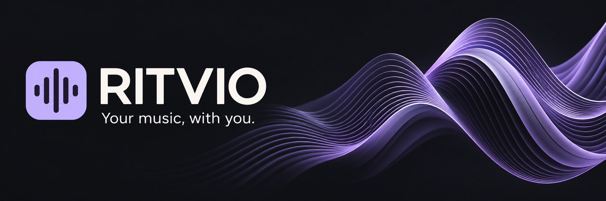
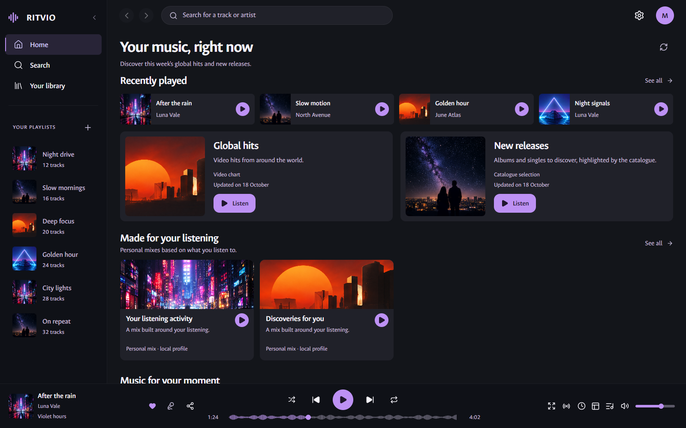

# RITVIO

**Player musicale gratuito e open source per Windows e Android.** Ricerca, scoperta, libreria locale e interfacce pensate per ciascuna piattaforma.

[English](README.md) · **Italiano** · [Scarica RITVIO](https://github.com/salvo13200/RITVIO/releases) · [Galleria](docs/SCREENSHOTS.md)

> Anteprima pubblica: **Windows 0.7.3** e **Android 1.2.0**. La copertura dei test sui dispositivi resta limitata: consulta [note e limiti](docs/RELEASE_NOTES.md).

Le schermate mostrano l'interfaccia reale in inglese, con dati dimostrativi e immagini sintetiche del progetto. Le catture mobile provengono dal renderer browser e non certificano il comportamento nativo su telefono. [Tutte le schermate](docs/SCREENSHOTS.md).

## Funzioni

- Ricerca di brani, artisti e album; classifiche globali, nuove uscite, radio e mix personali.
- Preferiti, playlist, artisti/album seguiti e cronologia conservati sul dispositivo.
- Coda modificabile, shuffle/repeat, timer, testi ed equalizzatore/controlli audio.
- Importazione/esportazione di playlist e condivisione di brani o versi come immagini 9:16.
- Windows: player desktop, vista immersiva e mini-player. Android: interfaccia touch, riproduzione nativa Media3 e controlli di sistema.

Italiano e inglese disponibili nelle impostazioni; metadati e testi mantengono la lingua originale. Alcune funzioni differiscono tra le piattaforme. Nessun account cloud, sincronizzazione tra dispositivi, download audio offline o collaborazione social in tempo reale. [Guida alle funzioni](docs/FEATURES.md).

## Download

Non servono Node.js, Python, chiavi API o account RITVIO per usare i pacchetti.

| Piattaforma | Download |
| --- | --- |
| Windows 10/11 x64 | [Installer](https://github.com/salvo13200/RITVIO/releases/download/windows-v0.7.3/RITVIO-0.7.3-setup.exe) · [Portatile](https://github.com/salvo13200/RITVIO/releases/download/windows-v0.7.3/RITVIO-0.7.3-portatile.exe) |
| Android 7.0+ ARM64/x86_64 | [APK firmata](https://github.com/salvo13200/RITVIO/releases/download/android-v1.2.0/RITVIO-Android-1.2.0.apk) |

Aggiorna sopra l'installazione ufficiale esistente senza disinstallare per conservare i dati locali. Gli EXE Windows non hanno firma Authenticode e possono attivare SmartScreen. Per l'uso quotidiano consigliamo l'installer: il portatile si estrae a ogni avvio e può partire lentamente. Una APK con firma diversa non può aggiornare l'app ufficiale. [Sorgenti e checksum](https://github.com/salvo13200/RITVIO/releases).

## Documentazione e contributi

[Indice della documentazione](docs/README.md) · [Compilazione](docs/BUILDING.md) · [Architettura](docs/ARCHITECTURE.md) · [Test](docs/TESTING.md) · [Contributi](CONTRIBUTING.md).

La documentazione tecnica e la galleria sono in inglese. Per segnalare un problema usa [le issue](https://github.com/salvo13200/RITVIO/issues) con versione, dispositivo e passaggi per riprodurlo. Il proprietario gestisce i merge; chiunque può proporre una PR da fork. Per vulnerabilità consulta [SECURITY.md](SECURITY.md).

## Privacy e licenze

La libreria resta locale; ricerca, streaming, copertine, metadati e testi contattano servizi esterni. Resolver non ufficiali, fonti e limiti sono descritti in **Impostazioni → Fonti e attribuzioni**, nel [README inglese](README.md#privacy-sources-and-licence) e in [PRIVACY.md](PRIVACY.md).

Sorgente originale sotto **GPL-3.0-only**: [licenza](LICENSE), [avvisi delle dipendenze e origine delle immagini](THIRD_PARTY_NOTICES.md). La licenza software non concede diritti su musica, testi, copertine o marchi dei provider.

## Sostieni lo sviluppo

Le donazioni sono facoltative e non sbloccano funzioni: [PayPal](https://www.paypal.me/sals126) · [Buy Me a Coffee](https://buymeacoffee.com/Sals126). I pagamenti sono gestiti dai provider e possono prevedere commissioni. Non sono presenti pagamenti nelle app.
