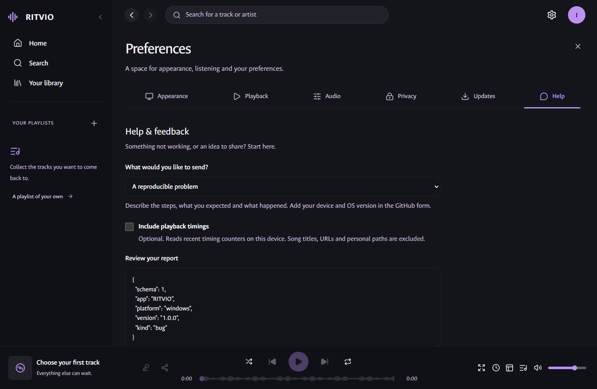
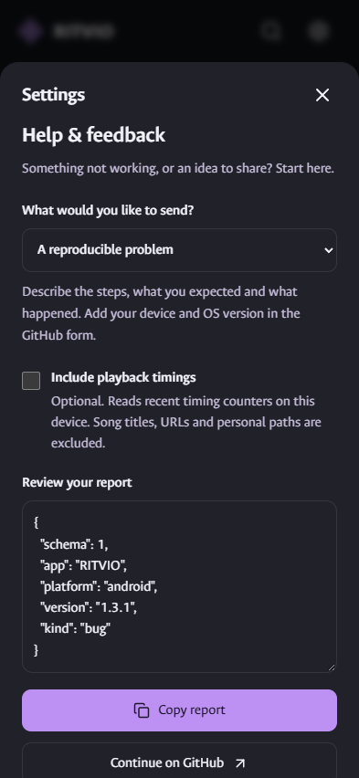
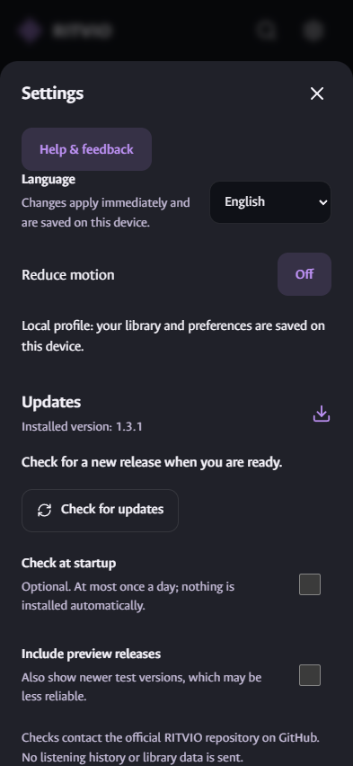
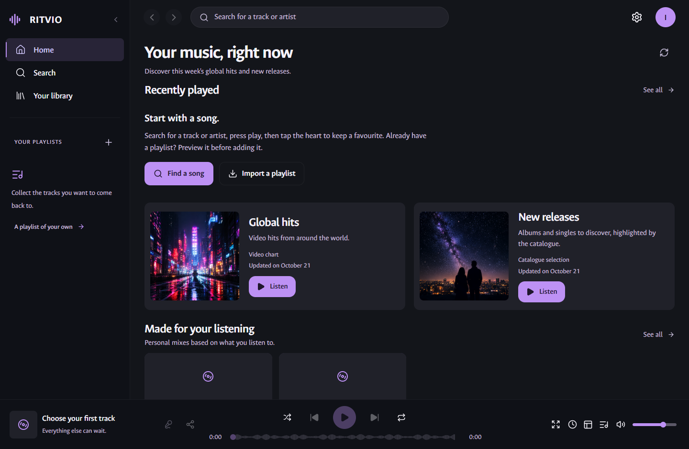
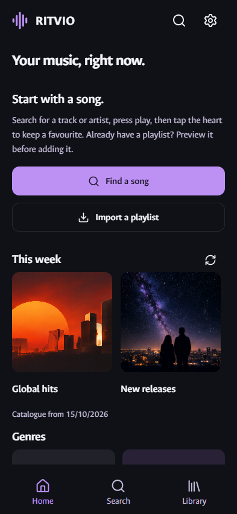
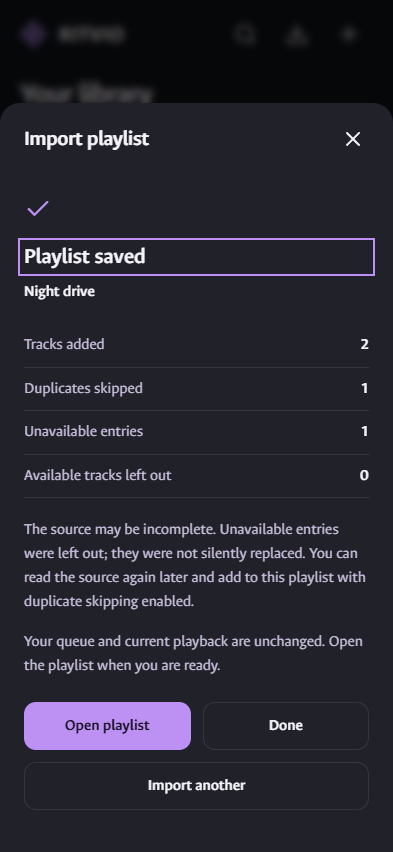
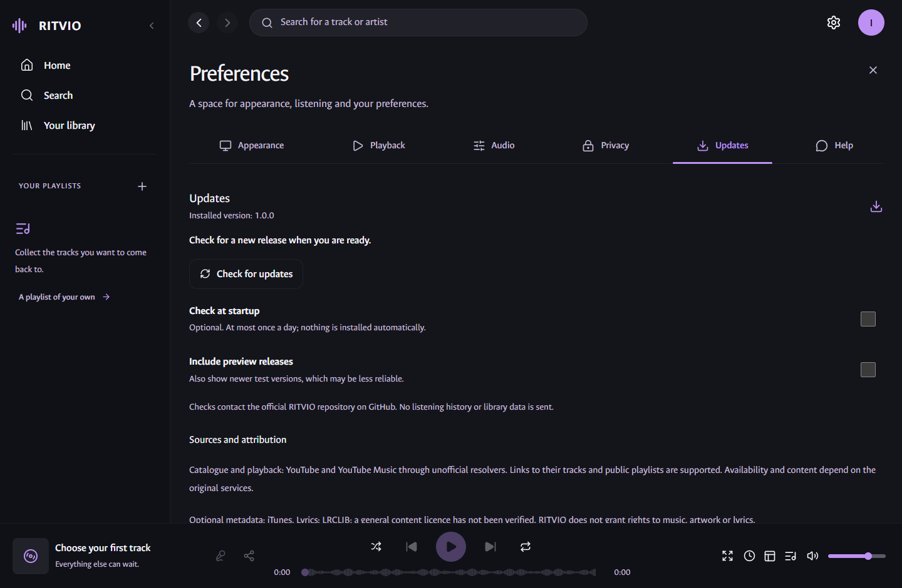
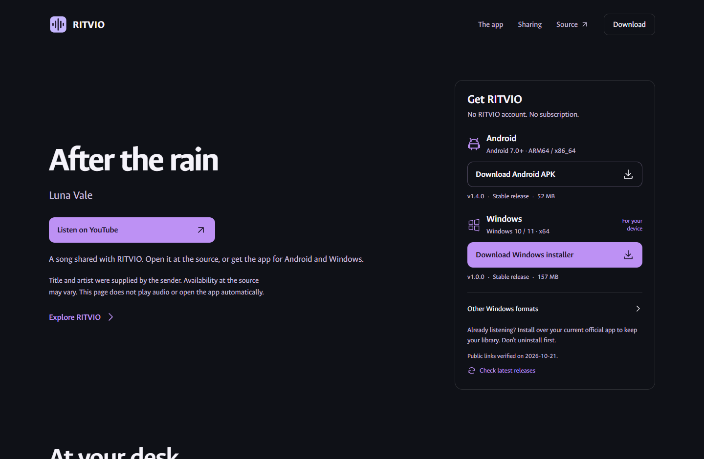

# A look at the current release

[Complete gallery](SCREENSHOTS.md) · [Feature guide](FEATURES.md) · [Quality status](QUALITY_STATUS.md)

These English captures show Windows 1.0.0 and Android 1.4.0 interface flows. The [stable packages](https://salvo13200.github.io/RITVIO/) have separate installed-package acceptance recorded in [Quality status](QUALITY_STATUS.md); screenshots are illustrative browser captures, not native-device evidence.

All views render the actual React application in Edge, using isolated synthetic data. Names, artwork, playlists, timings, import contents and verses are demonstration material. The artwork is existing documented project artwork; the verses are original. Native responses in the Android browser are fixtures. These are neither generated UI mockups nor proof of device, audio, background, clipboard or Gallery behavior. No personal profile or live catalogue was used.

## A short listening moment

[Watch the silent UI demonstration](media/adoption-demo.webm): search → playback UI → lyrics → consecutive verse selection → card preview. This is a recording of real application components with fixture playback, not a recording of native audio or a performance benchmark. The image card has no clickable link; caption support depends on the receiving application.

## Help that you can inspect

Choose a reproducible problem, interface feedback or a feature idea. Read the report before copying it. Playback counters are optional; app version and platform are the only context supplied when opening the GitHub form. Nothing submits itself.

[Windows help](media/desktop-support.webp) · [Android help](media/mobile-support.webp) · [Direct Settings access](media/mobile-support-entry.webp)

<p><a href="media/desktop-support.webp"></a></p>
<p><a href="media/mobile-support.webp"></a></p>
<p><a href="media/mobile-support-entry.webp"></a></p>

## Start listening, then keep your library

[Windows first listening](media/desktop-first-listen.webp) · [Android first listening](media/mobile-first-listen.webp) · [Import result](media/mobile-import-result.webp)

<p><a href="media/desktop-first-listen.webp"></a></p>
<p><a href="media/mobile-first-listen.webp"></a> <a href="media/mobile-import-result.webp"></a></p>

## Update and discover deliberately

[Update settings](media/desktop-updates.webp) · [Shared song reference](media/desktop-song-reference.webp)

<p><a href="media/desktop-updates.webp"></a></p>
<p><a href="media/desktop-song-reference.webp"></a></p>

The song reference uses the [public download page](https://salvo13200.github.io/RITVIO/), verified at desktop and phone widths during publication. The illustrative screenshot comes from a local build of that page. Social previews remain generic RITVIO previews; direct app opening is separate future work.

## Reproduce the materials

Run the normal development dependencies and Microsoft Edge, then:

```powershell
$env:RITVIO_CAPTURE_ADOPTION = '1'
pnpm exec playwright install ffmpeg
pnpm exec playwright test --config tests/config/playwright.support.config.ts tests/adoption-media.spec.ts
Remove-Item Env:RITVIO_CAPTURE_ADOPTION
python scripts/prepare-adoption.py
pnpm check:docs
pnpm release:check
```

The preparation step needs Pillow, like the existing gallery preparation tool. FFmpeg above is Playwright's optional recording dependency in its development cache; it is not an app dependency or a system-wide toolchain. Raw PNG/video output stays in ignored `test-results/adoption/`. The eight WebP conversions preserve decoded screenshot pixels and omit textual metadata/EXIF. `media/adoption.json` records origins, scope, sizes and checksums. The original approved gallery and banner are preserved. Refresh these media from the corresponding source when a visible feature or version changes.
