# Inside RITVIO

[Back to RITVIO](../README.md) · [Feature guide](FEATURES.md) · [Downloads](https://github.com/salvo13200/RITVIO/releases/tag/public-preview-1)

Actual React interfaces in English, with deterministic synthetic demo data and project-generated cover artwork. All tracks, artists, playlists, listening statistics and collection contents shown are illustrative. No personal profile, real listening history or external song lyric is included. The demo verses are original sample text.

Desktop/mobile interface captures use Microsoft Edge to render the real application components. They are not generated UI mockups, photographs or native-device test evidence. Background playback, system media controls and Gallery saving need separate phone checks; their behaviour cannot be proved by a screenshot. The two complete share cards below are actual exports of the app's canvas, not edited mockups.

## Sharing, with and without lyrics

  
  

### Choose the track or the words

The sharing flow has a track mode, a consecutive-lyrics selector and a preview before export. The two output images above retain the complete 9:16 canvas.

  <a href="media/mobile-share-track.webp">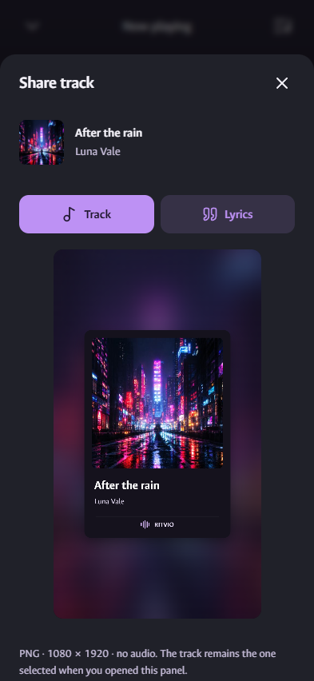</a>
  <a href="media/mobile-share-selection.webp">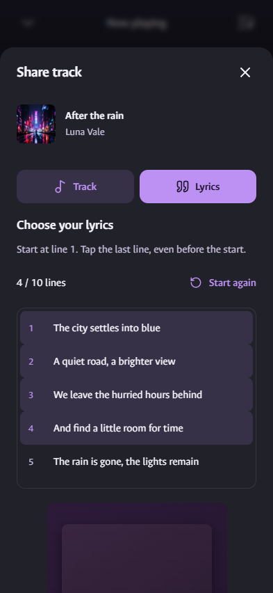</a>
  <a href="media/mobile-share-lyrics.webp">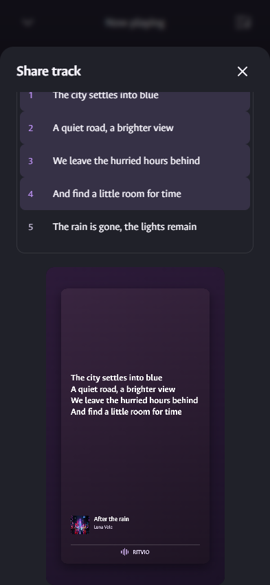</a>

## Feature-to-screen index

Every listed UI feature has a corresponding full-resolution image. Playback transport, seeking, shuffle and repeat share the player view; Android system/background features are documented alongside it, without inventing a system screenshot.

| Feature | Interface | Full-size image |
| --- | --- | --- |
| Home and discovery | Desktop | [View image](media/desktop-home.webp) |
| Library and playlists | Desktop | [View image](media/desktop-library.webp) |
| Full lyrics reader | Desktop | [View image](media/desktop-lyrics.webp) |
| Immersive listening | Desktop | [View image](media/desktop-immersive.webp) |
| Mini-player | Desktop | [View image](media/desktop-mini.webp) |
| Listening activity and privacy controls | Desktop | [View image](media/desktop-activity.webp) |
| Listening taste and personal mixes | Desktop | [View image](media/desktop-taste.webp) |
| Listening history | Desktop | [View image](media/desktop-history.webp) |
| Resume listening and weekly collections | Android | [View image](media/mobile-home.webp) |
| Track, artist and album search | Android | [View image](media/mobile-search.webp) |
| Local library | Android | [View image](media/mobile-library.webp) |
| Playback, seeking, shuffle and repeat | Android | [View image](media/mobile-player.webp) |
| Synced lyrics | Android | [View image](media/mobile-lyrics.webp) |
| Queue editing and autoplay | Android | [View image](media/mobile-queue.webp) |
| Equaliser and audio controls | Android | [View image](media/mobile-audio.webp) |
| Sleep timer | Android | [View image](media/mobile-timer.webp) |
| Track radio | Android | [View image](media/mobile-radio.webp) |
| Liked tracks | Android | [View image](media/mobile-favourites.webp) |
| Playlist contents | Android | [View image](media/mobile-playlist.webp) |
| Playlist rename, export and deletion controls | Android | [View image](media/mobile-playlist-actions.webp) |
| Artist and discography | Android | [View image](media/mobile-artist.webp) |
| Complete available album | Android | [View image](media/mobile-album.webp) |
| Playlist import preview | Android | [View image](media/mobile-import.webp) |
| Playlist file export | Android | [View image](media/mobile-export.webp) |
| Language, motion and source settings | Android | [View image](media/mobile-settings.webp) |
| Track sharing preview | Sharing | [View image](media/mobile-share-track.webp) |
| Consecutive lyrics selection | Sharing | [View image](media/mobile-share-selection.webp) |
| Lyrics sharing preview | Sharing | [View image](media/mobile-share-lyrics.webp) |
| Exported track image without lyrics | Sharing | [View image](media/share-card-track.webp) |
| Exported image with lyrics | Sharing | [View image](media/share-card-lyrics.webp) |

## Android interface

Open a feature to see its full English view. Click the image for the original size.

<strong>Resume listening and weekly collections</strong>

<strong>Track, artist and album search</strong>

<a href="media/mobile-search.webp">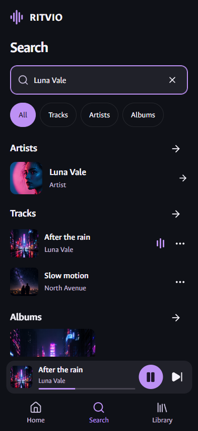</a>

<strong>Local library</strong>

<strong>Playback, seeking, shuffle and repeat</strong>

<strong>Synced lyrics</strong>

<a href="media/mobile-lyrics.webp">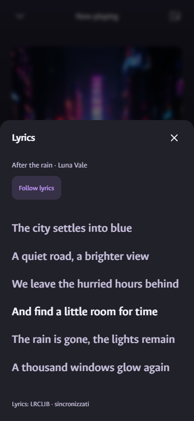</a>

<strong>Queue editing and autoplay</strong>

<a href="media/mobile-queue.webp">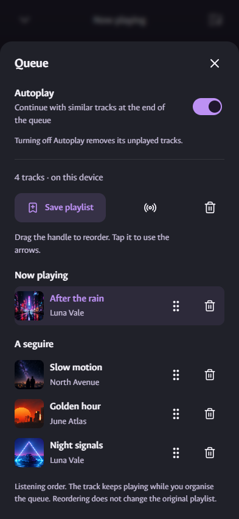</a>

<strong>Equaliser and audio controls</strong>

<a href="media/mobile-audio.webp">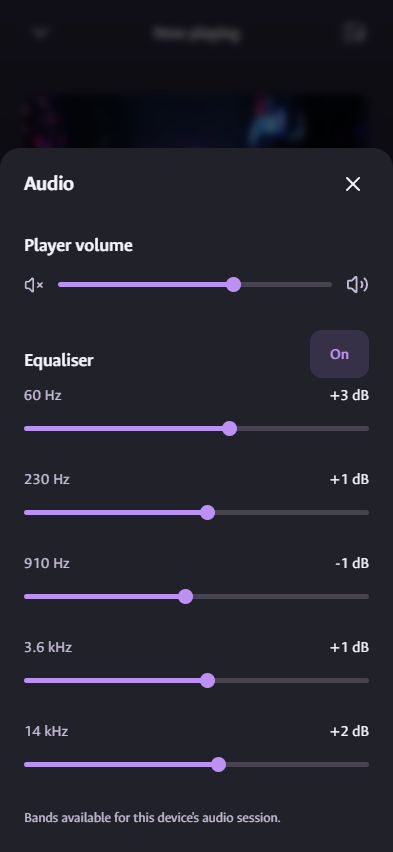</a>

<strong>Sleep timer</strong>

<a href="media/mobile-timer.webp">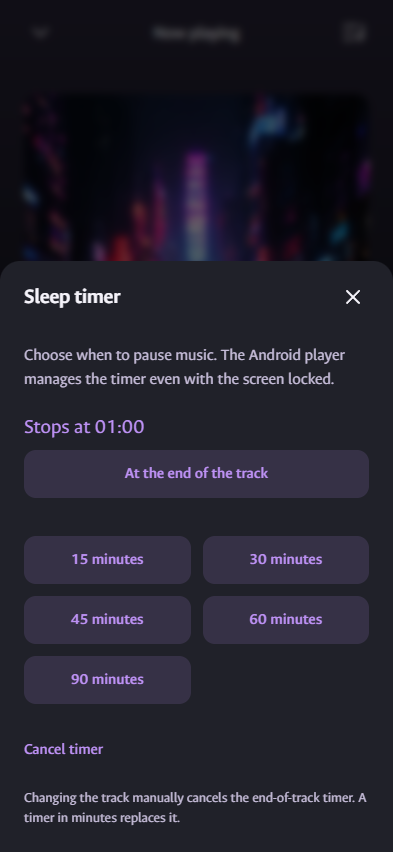</a>

<strong>Track radio</strong>

<a href="media/mobile-radio.webp">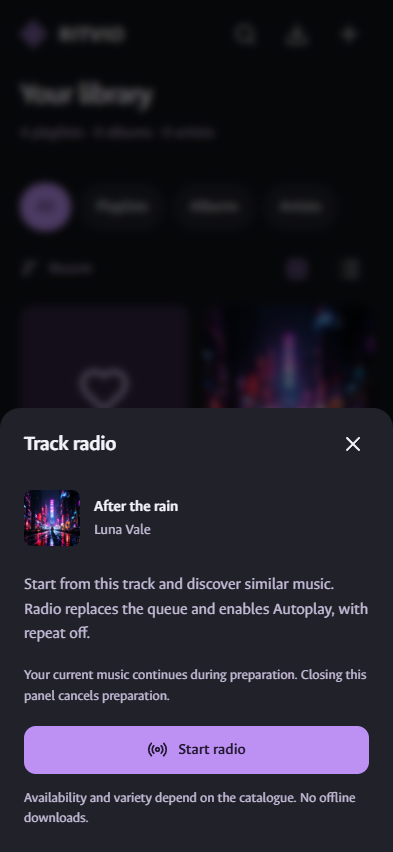</a>

<strong>Liked tracks</strong>

<a href="media/mobile-favourites.webp">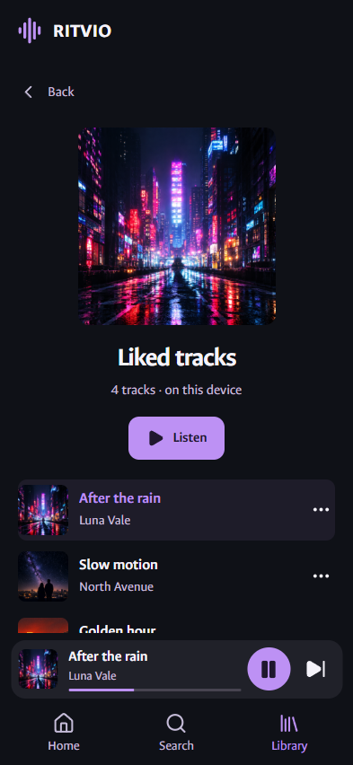</a>

<strong>Playlist contents</strong>

<a href="media/mobile-playlist.webp">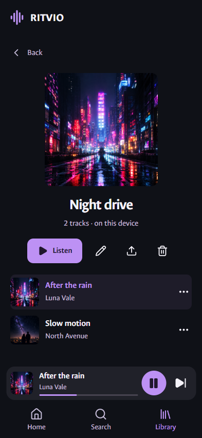</a>

<strong>Playlist rename, export and deletion controls</strong>

<a href="media/mobile-playlist-actions.webp">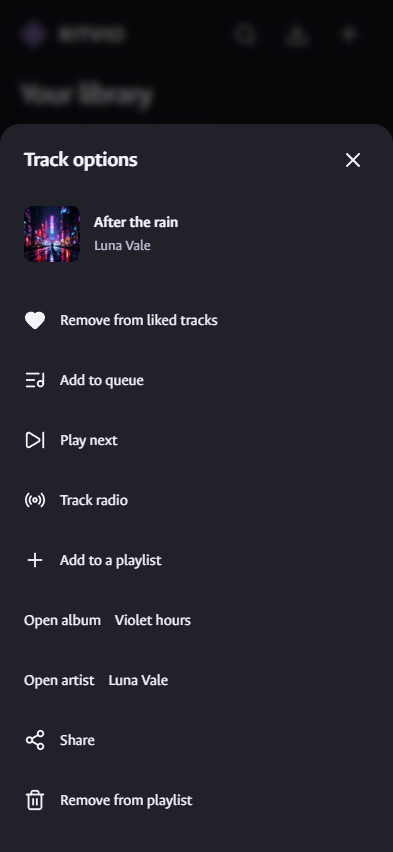</a>

<strong>Artist and discography</strong>

<a href="media/mobile-artist.webp">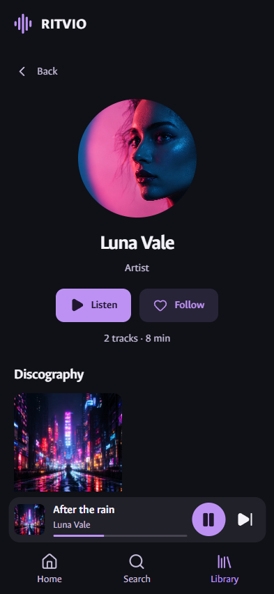</a>

<strong>Complete available album</strong>

<a href="media/mobile-album.webp">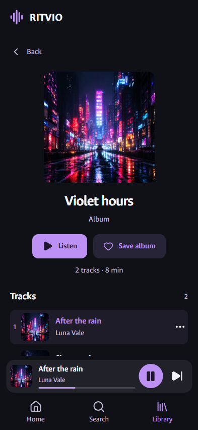</a>

<strong>Playlist import preview</strong>

<a href="media/mobile-import.webp">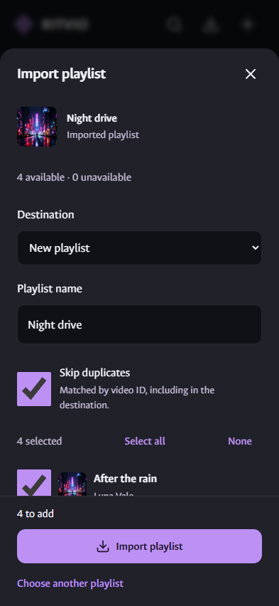</a>

<strong>Playlist file export</strong>

<a href="media/mobile-export.webp">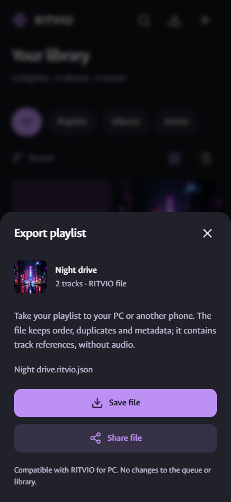</a>

<strong>Language, motion and source settings</strong>

<a href="media/mobile-settings.webp">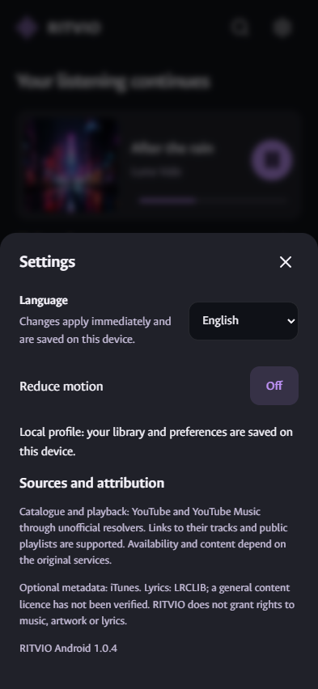</a>

## Desktop interface

Open a feature to see its full English view. Click the image for the original size.

<strong>Home and discovery</strong>

<strong>Library and playlists</strong>

<a href="media/desktop-library.webp">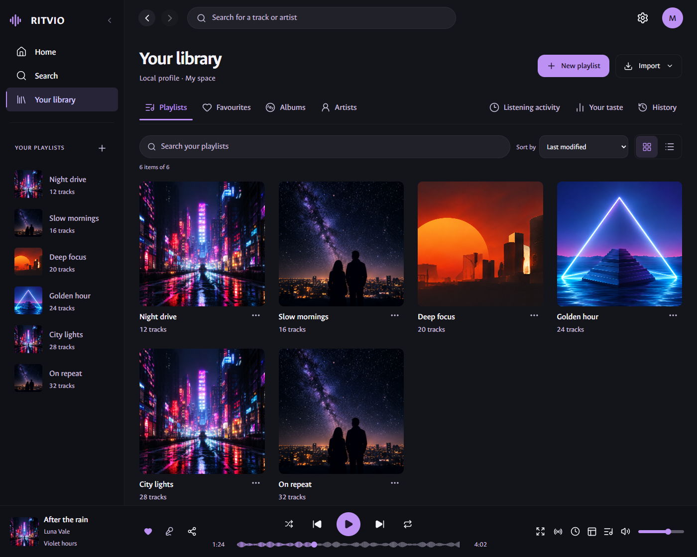</a>

<strong>Full lyrics reader</strong>

<a href="media/desktop-lyrics.webp">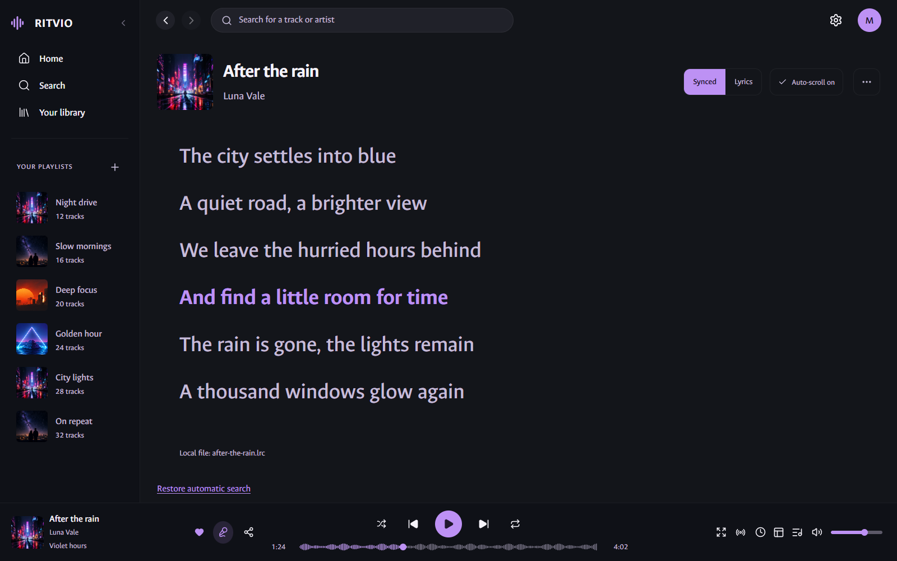</a>

<strong>Immersive listening</strong>

<a href="media/desktop-immersive.webp">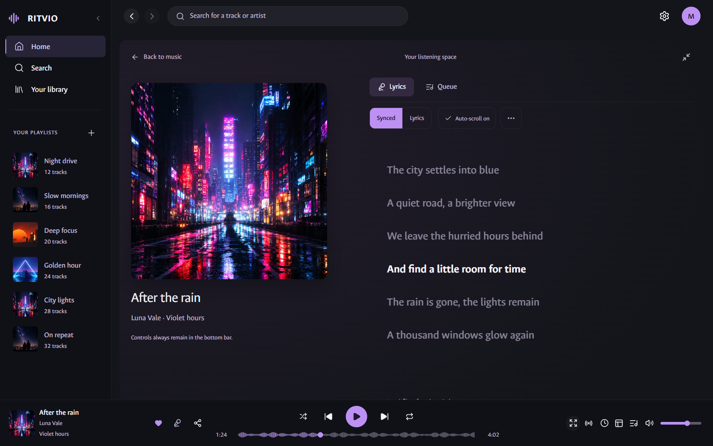</a>

<strong>Mini-player</strong>

<a href="media/desktop-mini.webp">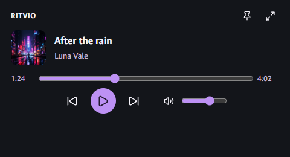</a>

<strong>Listening activity and privacy controls</strong>

<a href="media/desktop-activity.webp">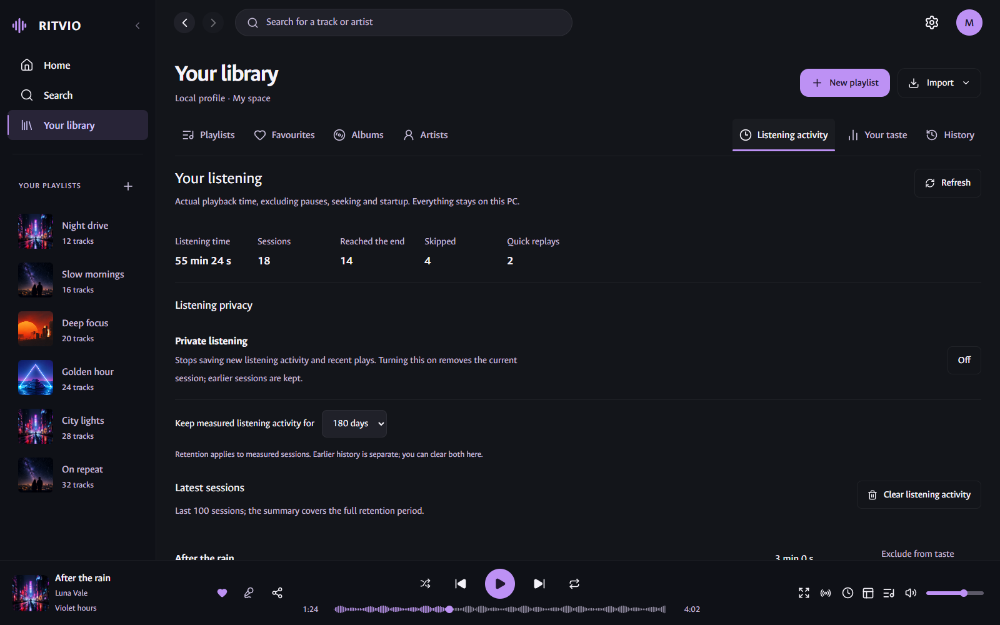</a>

<strong>Listening taste and personal mixes</strong>

<a href="media/desktop-taste.webp">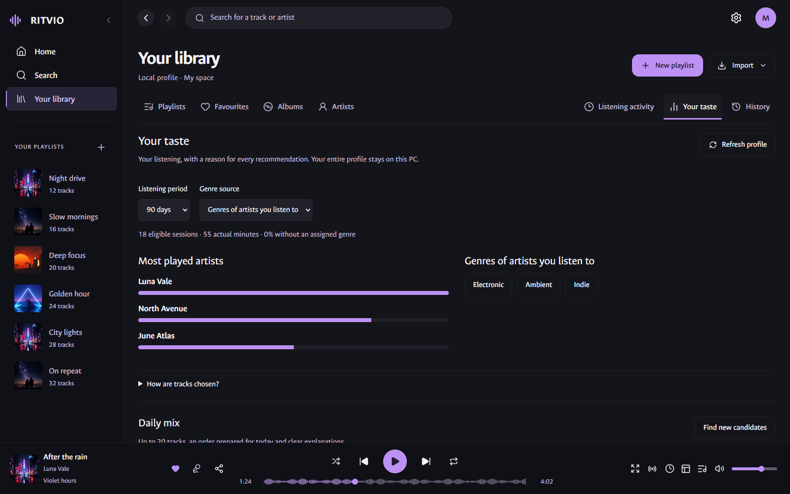</a>

<strong>Listening history</strong>

<a href="media/desktop-history.webp">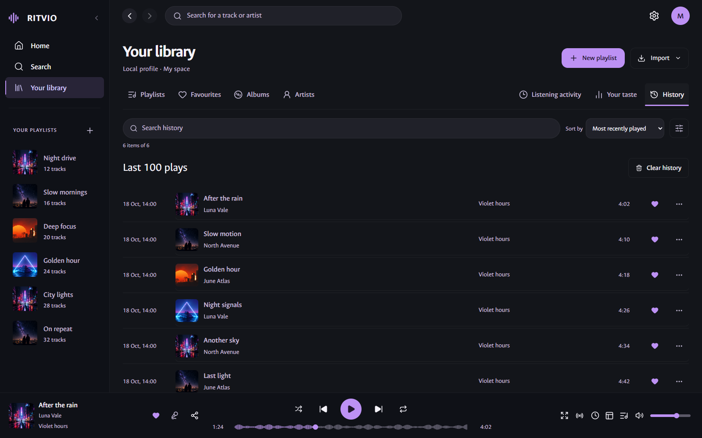</a>

## Capture and maintenance

`pnpm exec tsx scripts/capture-showcase.ts` renders isolated fixtures without accessing your profile or live catalogue services. Raw PNGs stay in ignored `test-results/showcase/`. `scripts/prepare-showcase.py` creates metadata-free lossless WebP copies and this gallery from `scripts/showcase-files.json`. See [media origins and maintenance](media/README.md).

The gallery shows the current source interface. Source/documentation updates do not replace previously published APK/EXE files; download versions are listed in [release notes](RELEASE_NOTES.md).
